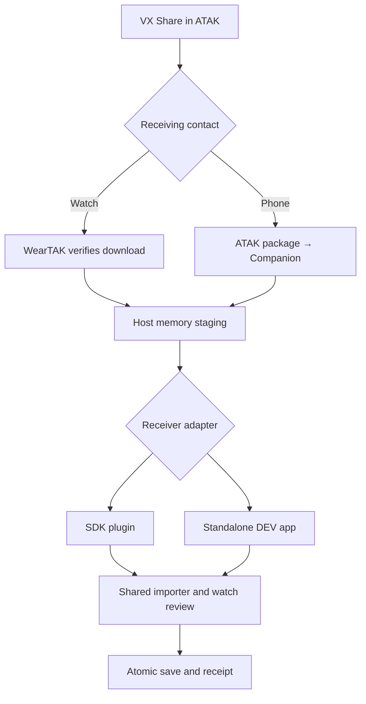

# WearTAK Voice architecture

One voice engine, importer, review screen and store is shared by the SDK plugin and
standalone builds. The transport adapters differ; channel validation and application do not.
The implementation is a development fork/proposal, not a claim that stock WearTAK ships it.

## Onboarding, starting with the sender

0. **An ATAK operator chooses Share in VX over GeoTalk.** VX produces its channel
   mission package and emits a standard `b-f-t-r` CoT fileshare offer. TAKS is one
   additional sender implementation; it is not required by the receiver protocol.
1. **Address the receiver that is actually connected.** For a directly connected
   watch, target the watch's TAK contact/UID. If the watch is linked through
   Companion, current WearTAK pauses its direct TAK transport: send to the phone's
   ATAK contact, or select a package the phone already received/created. Do not
   assume a disconnected watch automatically receives offers addressed to it.
2. **Receive and verify the package.** The watch's existing TAK downloader uses
   its configured server's `/Marti/sync/content?hash=…` endpoint and existing
   authenticated connection, with no redirect or client certificate sent to an
   advertised foreign URL. This source revision also has a separate, restricted
   local-peer downloader for offers received from a source-bound private IPv4
   peer on the receiving Wi-Fi link; it uses no TAK client identity. An arbitrary
   phone URL received over the server connection is not silently followed.
   The direct/server and local-peer cases still require actual VX hardware tests.
3. **Classify a candidate.** Reuse host ZIP/path/entry/expanded/manifest limits.
   The legacy multicastvoice `onReceiveAction` is a hint. Require referenced
   candidate content as well. Only the Voice importer performs complete TAKS
   JSON/binary semantic validation; a candidate offer is not an applied config.
4. **Stage in host memory.** The host selects exactly one ready, admitted receiver.
   It creates a one-use, short-lived handle bound to that receiver and the origin.
   Payload bytes stay in host-owned memory and are wiped after take/revocation.
   Only bounded receipt metadata is retained across host restarts.
5. **Take through Binder.** Authenticate UID, package, signer and live binding on
   every call. SDK plugins receive the optional V1 control through `hostExtras`.
   The DEV standalone adapter uses an explicitly enabled, same-signer Binder
   service. It is identified as a standalone app, not as an installed SDK plugin.
6. **Use the same importer.** Validate the exact byte count and SHA-256, decode
   supported VX ZIP/JSON/binary formats, and atomically retain one pending review.
   Bad packages and conflicting IDs cannot replace the active configuration or
   another pending review. Raw ZIPs are never extracted to arbitrary paths.
7. **Review on the watch.** Show the mission, server endpoints and channel names.
   The wearer accepts or rejects. Acceptance atomically saves the channel plan.
8. **Report the actual stage.** DOWNLOADED is host verification; STAGED is a durable
   plugin/app review; APPLIED is wearer acceptance. Errors/rejection are separate.
   Receipts are idempotent and can be synchronized after rebind. None of these
   states means Mumble is connected.
9. **Connect voice explicitly.** Use Voice's own configured Mumble login/TLS identity.
   If it is missing, offer Server & login or the existing acoustic setup flow.
   Importing channels does not connect, install trust, enroll a certificate, or
   expose WearTAK's private keys. The package has no Mumble password.

Companion forwards normalized `voice_channels_v1` mission JSON over its bonded,
ready, single-watch connection. The host verifies its payload SHA-256 and uses the
same broker and Binder receiver as the direct ZIP path. Original ZIP provenance
must not be described as watch-verified when only normalized JSON was received.
On the phone, use **Configure Watch → Voice channels**; it does not read VX's
private preference store or assume every incoming package is intended for a watch.

Standalone also opens/shares a VX ZIP directly through Android's file/content-URI
flow. This exercises the same importer, review, store, Mumble and PTT without
WearTAK. For full Companion/CoT integration testing, link it to the matching
WearTAK Dev host. Ordinary Android signing is sufficient; TAK plugin signing is
not needed for the standalone APK.

## Credentials and ownership

| Material | Used by | This channel flow |
| --- | --- | --- |
| Existing TAK connection login/certificate | WearTAK's TAK connection and package download | Neither changed nor exposed to Voice |
| VX mission/channel data | Shared Voice importer | Transferred and reviewed |
| Mumble login, voice client identity and private CA | Voice's own TLS connection | Existing Voice setup or an explicit Voice setup step |
| Callsign/team/color | TAK identity/display | Separate from authentication; existing ATAK identity transfer remains independent |

## Capabilities and versions

Open **Watch Details** from the connected watch screen to view the reported
software, transport, plugins, and capabilities. On ready/refresh, Companion asks for a nonce-bound capabilities snapshot. The watch
returns its package/version/code/commit/build time, Android release/API/build and
model; installed plugin versions and enabled/loaded state; SDK flags and supported
feature protocol versions; and a separate standalone receiver inventory. Voice
sending is enabled only with one live compatible receiver and a working host path.
Old-watch or stale responses cannot enable it. Firmware versions are diagnostic;
features are not inferred from a version-number comparison.

## Bounds and API

The host's general package limit stays 8 MB with its existing ZIP limits. The V1
voice receiver accepts a ZIP up to 262,144 bytes, expanded content up to 524,288
bytes and normalized JSON up to 32,700 bytes. The broker keeps at most four live
payload leases and 64 receipts. Leases last two minutes; operator review may
outlive a lease after a valid take. Large payloads are refused before inline
Binder delivery. There is no external broadcast receiver or temporary file grant.

`voice-package-api` is the shared development AIDL contract. It is additive to the
pinned WearTAK SDK and does not change frozen SDK parcel shapes/transaction IDs.
See [the upstream proposal](SDK_VOICE_PACKAGE_API_PROPOSAL.md).

## Audio and PTT

`MumbleConnection` provides verified TLS, bounded control/protobuf framing and
Opus audio over Mumble's TCP tunnel. UDP, whisper/private-call compatibility,
channel linking, multicast voice and automatic reconnect remain outside this alpha.
The Android pipeline uses 48 kHz mono Opus, AudioRecord during PTT and AudioTrack
for bounded receive playback. Credentials/private identities are stored in an
atomic AES-GCM vault using an Android Keystore key; backup is disabled.

PTT requires a confirmed channel join and permission to transmit. An app-delivered
BACK/STEM watch button is momentary in the foreground; system power/home mappings
remain under the OS. Optional media-button headset PTT supports actual hold events
or explicit click-toggle, with a 60-second limit. Sources are tracked separately;
release, cancellation, focus/route/network loss and teardown stop transmission and
never resume it automatically. Vendor BLE/SPP PTT devices need adapters. Buds
support depends on their actual Android events and needs physical qualification.
